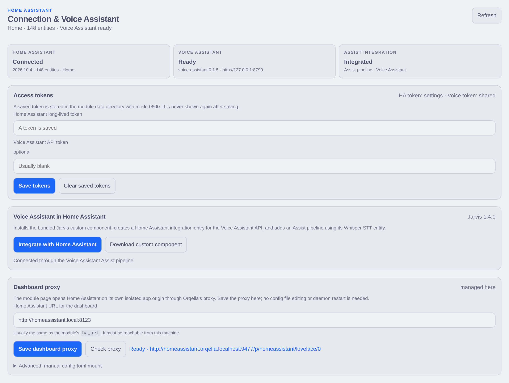

# Home Assistant



Opens your Home Assistant dashboard as an Orqella app surface and optionally integrates the
Voice Assistant module as a Home Assistant Assist conversation agent and Whisper
STT engine.

## Dashboard

Home Assistant runs on its own isolated origin through the Orqella proxy.
Open **Settings → Modules → Home Assistant** and save the **Dashboard proxy**
URL. The module calls the permissioned `proxy.configure` host API, so there is
no `config.toml` editing or daemon restart.

For Home Assistant on another machine, enter that URL and make sure this
Orqella daemon can reach it. The host is fixed to
`homeassistant.orqella.localhost` and WebSockets are enabled automatically.

The module declares `node.proxy.manage:homeassistant` for this. It is a
sensitive permission; if an update adds it, approve it in **Settings →
Modules → Home Assistant → Review permissions** once. Older daemons without
`proxy.configure` still show the manual mount snippet in the advanced section.

The module page checks the mount and calls `app.open` with the configured
`dashboard_path` (default `/lovelace/0`).

## REST and WebSocket

The sidecar uses:

- `GET /api/config` and `GET /api/states` for status and entity counts.
- `ws://<ha>/api/websocket` for config entries, Assist pipelines, and restart.
- `GET <voice-assistant>/health` to detect the Voice Assistant API.

It works with a local container or a remote Home Assistant. Tokens can come
from:

1. a token saved in Settings (module `data/ha.token`, mode `0600`);
2. the configured token command, if any (blank by default; Linux users can point it at `secret-tool`, macOS users at `security find-generic-password`, and Windows users can leave it blank and save a token in Settings);
3. `HA_TOKEN` in the daemon environment.

For remote Home Assistant, save a long-lived token in Settings.

Optional dependency: **Voice Assistant**. Installing it adds the Assist
conversation agent and Whisper STT pipeline; the Home Assistant dashboard and
proxy work without it.

## Voice Assistant integration

The module bundles the Jarvis custom component under `integration/jarvis`.

The **Integrate with Home Assistant** button:

1. installs the component into `<ha_config_dir>/custom_components/jarvis` when
   a local config directory is configured and writable; otherwise use the
   downloadable bundle;
2. creates a `jarvis` config entry pointing at the Voice Assistant API;
3. creates an Assist pipeline using the `stt.jarvis_whisper` entity if one does
   not exist.

If Home Assistant is remote or its config directory is not writable, use
**Download custom component**, copy `custom_components/jarvis` into the HA
config directory, restart HA, then click **Integrate** again.

The integration uses the same API paths as the Voice Assistant engine:
`POST /api/conversation` and `POST /api/stt`. Start the Voice Assistant API
(usually `jarvis serve` on `127.0.0.1:8790`) before integrating.

## Install

```bash
orqella module install https://github.com/orqella/orqella-home-assistant
```

Open **Home Assistant** from the sidebar. **Settings → Modules**, select
**Home Assistant**, to reach the connection, dashboard proxy, tokens, and
integration controls.

## Security

- The sidecar is unsandboxed because it may install a component into the HA
  config directory and run a local token command.
- Saved tokens are written with mode `0600`; token values are never returned by
  the status API or logged.
- The HA custom component talks to Voice Assistant only; it does not proxy
  Home Assistant itself.
- Module iframes cannot use native browser confirm/prompt dialogs, so the
  settings page uses in-page dialogs and opens the component download in a
  popup. Use HTTPS for a remote Home Assistant; tokens over plain HTTP are not
  acceptable outside loopback.
- A `~` in the HA config directory is resolved against the real user home via
  `ORQELLA_HOST_HOME`, not the sidecar's module home.
